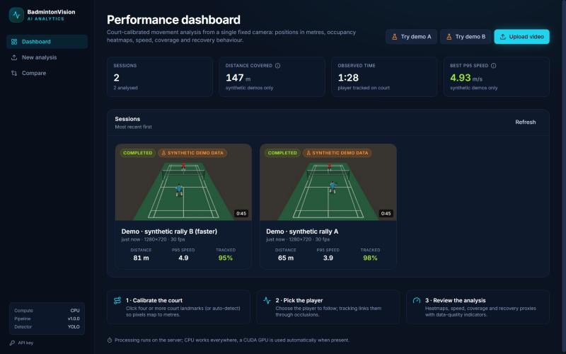
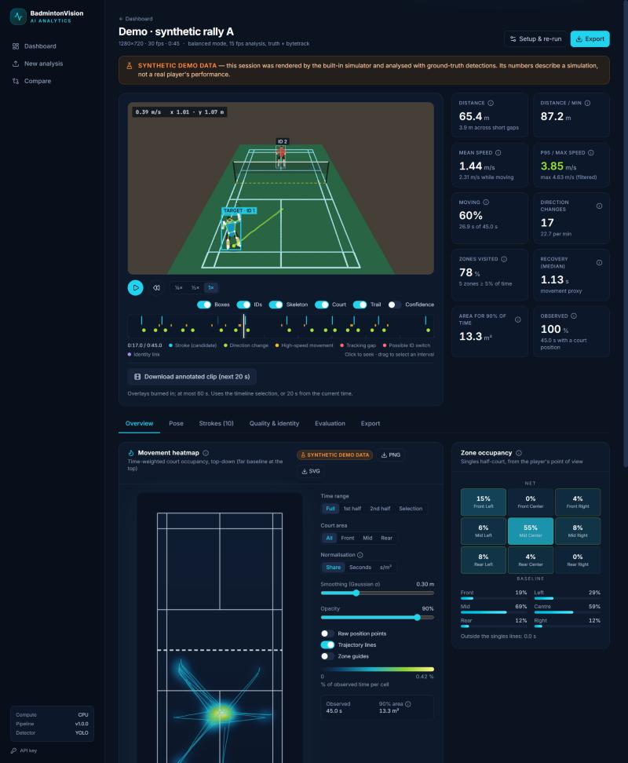
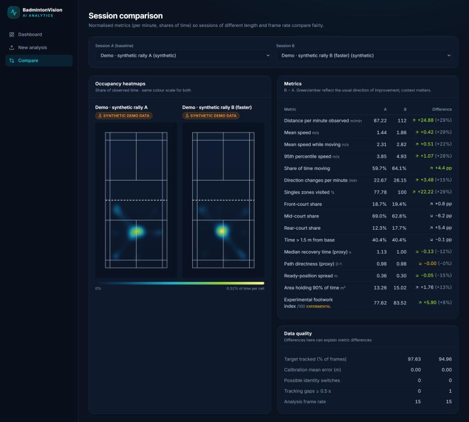
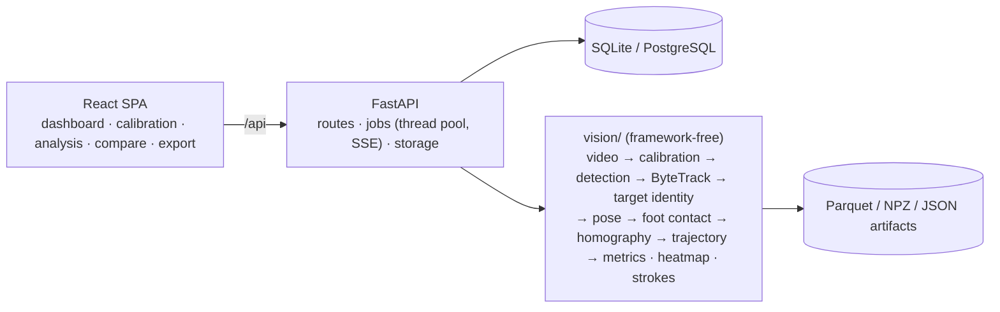

# BadmintonVision AI

**Turn a single fixed-camera badminton video into court positions, movement heatmaps and footwork
metrics — with every number traceable to a documented method and a data-quality report.**

[](https://github.com/vietanh411/Badminton_Trainer/actions/workflows/ci.yml)


Upload a match or practice clip, mark the court, click the player you care about, and get:
a time-weighted court-occupancy heatmap, distance and speed profiles, zone coverage, direction
changes, recovery-to-base and footwork proxies, candidate stroke events, an annotated video player,
session comparison, and CSV / JSON / PNG / SVG / PDF exports.

| Dashboard | Analysis: annotated playback, metrics and heatmap |
|---|---|
|  |  |



*Screenshots show the built-in synthetic demo sessions (labelled SYNTHETIC DEMO DATA in the app); no real
player data is included in this repository.*

## Why this project

Coaches and players review footage by eye. Commercial tracking systems use multi-camera rigs. This
project asks how much reliable movement information one ordinary camera behind the baseline can
give — and, as importantly, how to *say how reliable it is*. The emphasis is on measurement
correctness (real-world metres, timestamp-aware time weighting, no invented data across tracking gaps),
explicit uncertainty (confidence per position, identity-link evidence, calibration error), and an
evaluation framework rather than unverifiable accuracy claims.

## Features

| Area | What it does | Status |
|---|---|---|
| Video ingestion | Streaming upload with size cap, extension + magic-byte + decode validation, metadata, rotation, thumbnails, timestamp-aware sampled decoding, browser proxy for non-web codecs | ✅ tested |
| Court calibration | Manual landmark editor with live reprojection error (m and px), RANSAC, degeneracy checks; automatic court-line detection as an editable suggestion | ✅ tested (synthetic + negative real-photo checks) |
| Detection & tracking | YOLO11 or MediaPipe EfficientDet person detection; ByteTrack re-implemented per job; optional BoT-SORT; court-region filtering | ✅ tested |
| Target identity | Seed from the user's click, link fragments through occlusions with motion + appearance evidence, manual corrections, switch and gap flags | ✅ tested |
| Pose | MediaPipe Pose on the player crop, landmarks restored to frame coordinates, visibility kept, posture proxies | ✅ tested on real people |
| Court position | Heel/toe foot-contact point → homography, box fallback, confidence per sample | ✅ tested |
| Trajectory | Bounds, robust outliers, speed gate, short-gap interpolation only, Savitzky–Golay, raw kept alongside filtered | ✅ tested |
| Movement metrics | Distance, speed distribution, moving/stationary, zones (3×3 player-relative), direction changes with hysteresis, recovery and footwork proxies, opt-out experimental composite | ✅ tested |
| Heatmaps | Time-weighted Gaussian KDE in metres; whole session, interval, halves, front/mid/rear; share/seconds/density; PNG/SVG | ✅ tested (rate-independence test) |
| Strokes | Wrist-speed event detection (supported) + heuristic side/height attributes (experimental); review & labelling UI; grouped-CV classifier pipeline | ⚠️ experimental — no real-footage validation yet |
| App | Dashboard, upload & calibration wizard, analysis page with annotated playback, compare, export, demo mode | ✅ |
| Evaluation | Detection P/R, MOTA/IDF1/ID switches, target accuracy, calibration & position error, event P/R/F1, macro-F1, ECE; synthetic benchmark; performance benchmark | ✅ (real-footage benchmark needs annotated video) |
| Ops | FastAPI + OpenAPI, SQLite/PostgreSQL + Alembic, background jobs with SSE progress & cancel, API key, Docker Compose, GitHub Actions | ✅ (Docker files not built locally — see deployment notes) |

## Architecture



Details: [docs/architecture.md](docs/architecture.md).

## Methodology in brief

1. **Homography** from ≥ 4 clicked court landmarks (BWF dimensions in metres), RANSAC with ≥ 6, rejected
   when degenerate, ill-conditioned or inconsistent; reprojection error reported per point.
2. **Detection + ByteTrack**, then the user's chosen player is followed across tracker fragments using
   physical reachability and shirt-colour similarity; every link is logged as evidence.
3. **Position = feet, not hips.** The midpoint of the heel/toe landmarks is projected through the floor
   homography; projecting the hip would shift the position by metres.
4. **Trajectory processing** rejects impossible points, interpolates only gaps ≤ 0.4 s, smooths per segment,
   and differentiates on real timestamps.
5. **Metrics are time-weighted** (each sample counts for the seconds it represents), so 15 fps and 60 fps
   recordings agree, and nothing is accumulated across tracking gaps.
6. **Strokes** are wrist-speed peaks normalised by torso length; side and height are heuristics; smash /
   clear / drop are deliberately *not* predicted from pose alone.

Full definitions of every metric: [docs/methodology.md](docs/methodology.md).

## Evaluation

<!-- EVALUATION -->

Real-footage accuracy is **not yet measured**: it requires annotated badminton video, which this repository
does not include. The protocol and tooling to do it are ready: [docs/evaluation.md](docs/evaluation.md),
[docs/annotation.md](docs/annotation.md).

## Quick start

Prerequisites: Python 3.11–3.13, Node 20+.

```bash
git clone https://github.com/vietanh411/Badminton_Trainer.git && cd Badminton_Trainer

# Backend
cd backend
python -m venv .venv && source .venv/bin/activate          # Windows: .venv\Scripts\activate
pip install --index-url https://download.pytorch.org/whl/cpu torch torchvision
pip install -e ".[yolo,dev]"
python ../scripts/download_models.py                        # ~85 MB of official weights
uvicorn app.main:app --port 8000                            # API + docs at http://localhost:8000/docs

# Frontend (second terminal)
cd frontend && npm install && npm run dev                   # http://localhost:5173
```

Click **Try demo** on the dashboard to generate and analyse a clearly labelled synthetic rally, or
upload your own clip. Docker: `docker compose up --build` → http://localhost:8080
([docs/deployment.md](docs/deployment.md)).

### Filming for good results

* Tripod behind the baseline (or high in a corner), the whole court or at least the player's half and
  the lines around it in view; don't move or zoom the camera.
* The player's feet visible most of the time; 720p or 1080p at 25–60 fps.
* One player per analysis (singles first). Doubles footage works for tracking, but identity linking is
  tuned for a single target.

## Tests

```bash
cd backend && pytest -q                 # unit + API integration + real-model tests (skipped without weights)
cd frontend && npm run typecheck && npm test && npm run build
python scripts/run_synthetic_benchmark.py
python scripts/benchmark_performance.py
```

<!-- TESTS -->

## Example API usage

```bash
# upload → session
curl -F "file=@rally.mp4" http://localhost:8000/api/videos
# calibrate with landmark clicks (full-resolution pixels)
curl -X POST http://localhost:8000/api/sessions/$SID/calibration -H "Content-Type: application/json" -d '{
  "image_width": 1920, "image_height": 1080, "points": [
    {"id": "near_baseline__left_doubles",  "x": 312,  "y": 1012},
    {"id": "near_baseline__right_doubles", "x": 1608, "y": 1010},
    {"id": "far_baseline__left_doubles",   "x": 702,  "y": 318},
    {"id": "far_baseline__right_doubles",  "x": 1221, "y": 317},
    {"id": "near_short_service__left_singles", "x": 600, "y": 640}]}'
# choose the player and start the analysis
curl -X POST http://localhost:8000/api/sessions/$SID/player-selection -H "Content-Type: application/json" \
     -d '{"t": 2.0, "bbox": [820, 520, 960, 900]}'
curl -X POST http://localhost:8000/api/sessions/$SID/analyze -H "Content-Type: application/json" -d '{"performance_mode": "balanced"}'
curl http://localhost:8000/api/jobs/$JOB                              # or stream: /api/jobs/$JOB/events
curl "http://localhost:8000/api/sessions/$SID/heatmap?preset=second_half&normalize=share"
curl -o report.pdf http://localhost:8000/api/sessions/$SID/report
```

Endpoints: `POST /api/videos`, `GET /api/videos/{id}[/preview|/frame|/thumbnail]`,
`POST /api/sessions/{id}/calibration[/auto]`, `GET /api/sessions/{id}/detections`,
`POST /api/sessions/{id}/player-selection|corrections|analyze`, `GET|POST /api/jobs/{id}[/cancel|/events]`,
`GET /api/sessions/{id}/metrics|trajectory|heatmap|events|annotations|pose-series|tracks|strokes|report|annotated-video|export/{kind}|evaluation|benchmark[/template]`,
`GET /api/compare?a=&b=`, `POST /api/demo`. Interactive docs at `/docs`.

## Project layout

```
backend/
  app/            FastAPI app: api/, core/, db/, schemas/, services/, workers/
  vision/         CV & analytics core: video, geometry, calibration, detection, tracking, pose,
                  trajectory, analytics, strokes, visualization, evaluation, synthetic, pipeline.py
  migrations/     Alembic
  tests/          pytest (unit, API integration, real-model)
frontend/         React + TypeScript + Vite + Tailwind
scripts/          model download, synthetic & performance benchmarks, evaluation, classifier training
benchmarks/       committed benchmark results (synthetic and performance)
docs/             architecture, methodology, evaluation, annotation, deployment, model cards
docker/ + docker-compose*.yml, .github/workflows/ci.yml
```

## Data, models and licences

* **No footage is included.** Demo mode and tests use footage rendered by `vision/synthetic/` with exact
  ground truth; the UI, API, exports and PDF mark it **SYNTHETIC** everywhere.
* Models: Ultralytics YOLO11 (AGPL-3.0, optional), MediaPipe Pose Landmarker and EfficientDet-Lite0
  (Apache-2.0), downloaded from official sources by `scripts/download_models.py`.
* Code: MIT. See [THIRD_PARTY_NOTICES.md](THIRD_PARTY_NOTICES.md) — installing the `yolo` extra brings
  AGPL obligations for distribution; an Apache/MIT-only stack is one flag away.
* Model card for the optional stroke classifier: [docs/model_cards/stroke_classifier.md](docs/model_cards/stroke_classifier.md).

## Known limitations

* One fixed camera: camera motion or zoom breaks the calibration.
* Feet must be visible for the best positions; the far-side player is small and noisier.
* Pose angles are 2-D proxies; no medical or injury interpretation is offered.
* Recovery/footwork values are movement proxies — the shuttle and shot timing are not tracked.
* Stroke attributes are experimental, and smash/clear/drop are not inferred.
* Real-footage accuracy has not been measured yet (no annotated footage in the repo).
* Jobs run in the API process; a separate queue/worker is needed for multi-machine scaling.

## Future work

Shuttle tracking (TrackNet-style) to time shots and enable true recovery-after-shot metrics; video
stabilisation for handheld footage; a learned re-identification embedding for doubles; an annotated
real-footage benchmark with session-level splits; an in-browser box/ground-contact annotation canvas;
a distributed job queue for cloud deployment.

---

Replaces the earlier *Shuttle Coach* prototype (LLM feedback on keyframes), which remains in the git
history.
