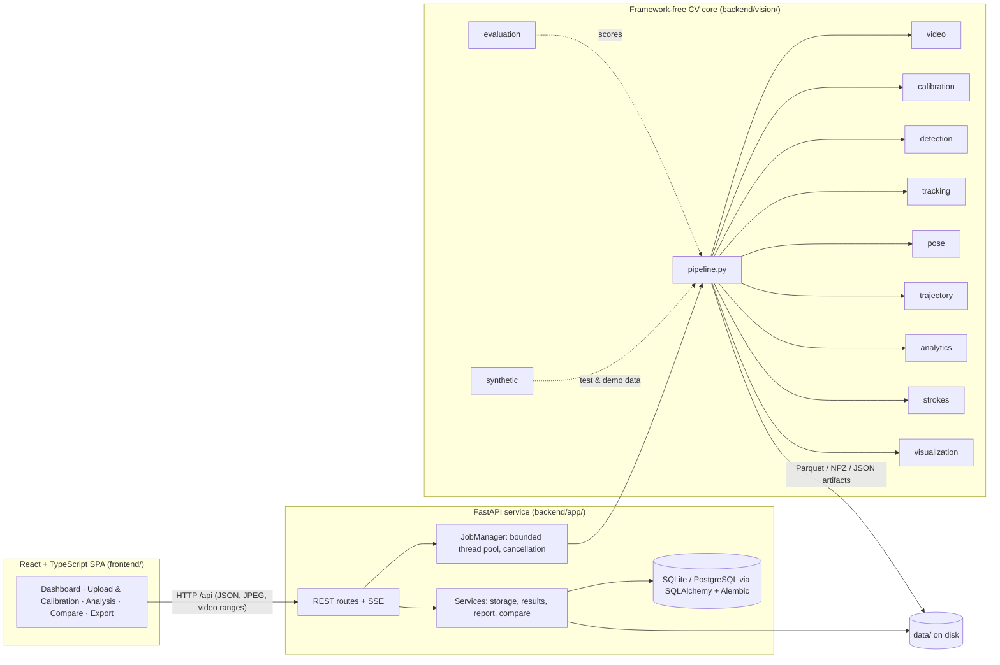
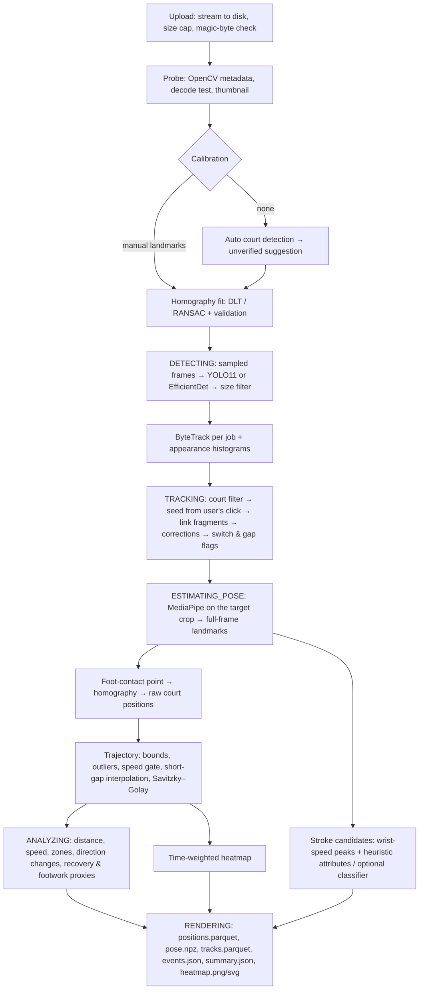
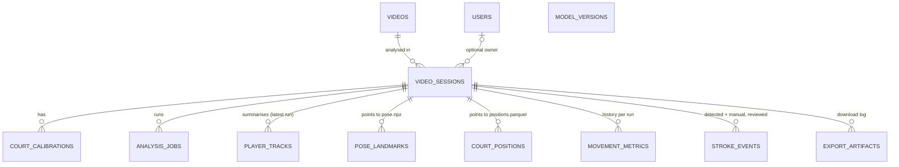

# Architecture

BadmintonVision AI is a monorepo with three layers that only talk through narrow interfaces:



* `backend/vision/` has no web or database code. Every stage is a plain function or class that can
  be unit-tested, scripted (`scripts/`) or used from a notebook.
* `backend/app/` owns persistence, HTTP, validation, security and the job lifecycle.
* `frontend/` is a static SPA. In development Vite proxies `/api` to the backend; in Docker nginx does.

## Analysis pipeline



Job states exposed to the UI: `QUEUED → VALIDATING → CALIBRATING → DETECTING → TRACKING →
ESTIMATING_POSE → ANALYZING → RENDERING → COMPLETED` (or `FAILED` / `CANCELLED`). Progress is the
weighted completion of the current stage; it is written to the database at most every 0.5 s and
streamed to the browser over Server-Sent Events (`GET /api/jobs/{id}/events`), with polling as a
fallback.

### Concurrency and isolation

* Analyses run in a `ThreadPoolExecutor` (default 1 worker, `BV_MAX_CONCURRENT_JOBS`), never on the
  asyncio event loop; blocking request work (frame decoding, auto-calibration) uses `asyncio.to_thread`.
* The queue is bounded (`BV_MAX_QUEUED_JOBS`); extra requests get HTTP 429. One running job per session.
* Each job constructs its own detector, tracker and pose estimator, so no tracker state or model
  session is shared between videos. The BoT-SORT option creates a fresh Ultralytics `YOLO` object
  per job for the same reason.
* Cancellation sets a per-job `threading.Event` that frame loops check between frames.
* On start-up, jobs left in a running state by a crash are marked `FAILED` with an explanation.

### Caching

Stage outputs are cached under `data/cache/` with keys derived from the **video content hash**
(SHA-256 computed while streaming the upload) and only the settings that affect that stage:

| Cache | Key includes | Re-used when you change… |
|---|---|---|
| `det_<key>/` (samples, detections, tracks, appearance) | video hash, detector, tracker, analysis fps, width, weights, ByteTrack params | calibration, player selection, corrections, any analytics setting |
| `pose_<key>.npz` | detection key, pose model, target boxes | calibration, trajectory/metric/heatmap/stroke settings |

Everything after pose (positions, filtering, metrics, strokes, heatmaps) is recomputed on every run;
it takes well under a second for typical clips. Heatmap variants (interval, zone, smoothing,
normalisation) are computed on request from `positions.parquet`, so changing visualisation settings
never re-runs a model.

### Memory

Frames are decoded and processed one at a time (`vision/video/reader.iter_frames`), so memory does
not grow with video length. Per-frame outputs are small (boxes, 33 landmarks, one position).

## Storage layout

```
data/
  badmintonvision.db            SQLite (default; set BV_DATABASE_URL for PostgreSQL)
  uploads/<video_id>/           source.<ext>, thumbnail.jpg, proxy.webm (if transcoded), truth.json (synthetic only)
  sessions/<session_id>/
    results/<job_id>/           positions.parquet, tracks.parquet, detections.parquet, samples.parquet,
                                pose.npz, events.json, summary.json, heatmap.png, heatmap.svg
    benchmark/annotations.json  manual evaluation annotations
  cache/                        stage caches (safe to delete)
  tmp/                          in-flight uploads (deleted on success or failure)
  models/strokes/<version>/     trained stroke classifiers + model cards
```

Only the latest results directory per session is kept; older ones are deleted after a successful run.

## Data model



Bulky per-frame data lives in Parquet/NPZ files referenced from the database; videos are never
stored as BLOBs. Schema changes go through Alembic (`backend/migrations/`), applied automatically on
start-up.

## Module map

| Path | Responsibility |
|---|---|
| `vision/video/` | Container sniffing, metadata, timestamp-aware sampled decoding, thumbnails, browser proxy encoding |
| `vision/geometry/court.py` | BWF court model in metres, keypoints, lines, half-court coordinates, zones |
| `vision/calibration/` | Homography fitting/validation (`homography.py`), automatic court detection (`auto.py`) |
| `vision/detection/` | Detector protocol, court-region filtering, YOLO / MediaPipe / synthetic-truth backends |
| `vision/tracking/` | ByteTrack, Ultralytics BoT-SORT adapter, appearance descriptor, target identity resolution |
| `vision/pose/` | MediaPipe Pose on crops with coordinate restoration, angle/posture proxies |
| `vision/trajectory/` | Foot-contact positions, filtering, interpolation, smoothing, derivatives, sample weights |
| `vision/analytics/` | Movement metrics, recovery & footwork proxies, experimental composite, heatmaps |
| `vision/strokes/` | Event detection, heuristic attributes, supervised classifier + model card |
| `vision/evaluation/` | Detection/MOT/IDF1/position/event/classification metrics, annotation-file scoring |
| `vision/synthetic/` | Rendered scenes with exact ground truth (tests, demo, benchmark) |
| `vision/pipeline.py` | Stage orchestration, caching, artifact writing |
| `app/api/` | REST endpoints (OpenAPI at `/docs`) |
| `app/workers/jobs.py` | Background job manager |
| `app/services/` | Storage safety, artifact readers, PDF report, comparisons |
